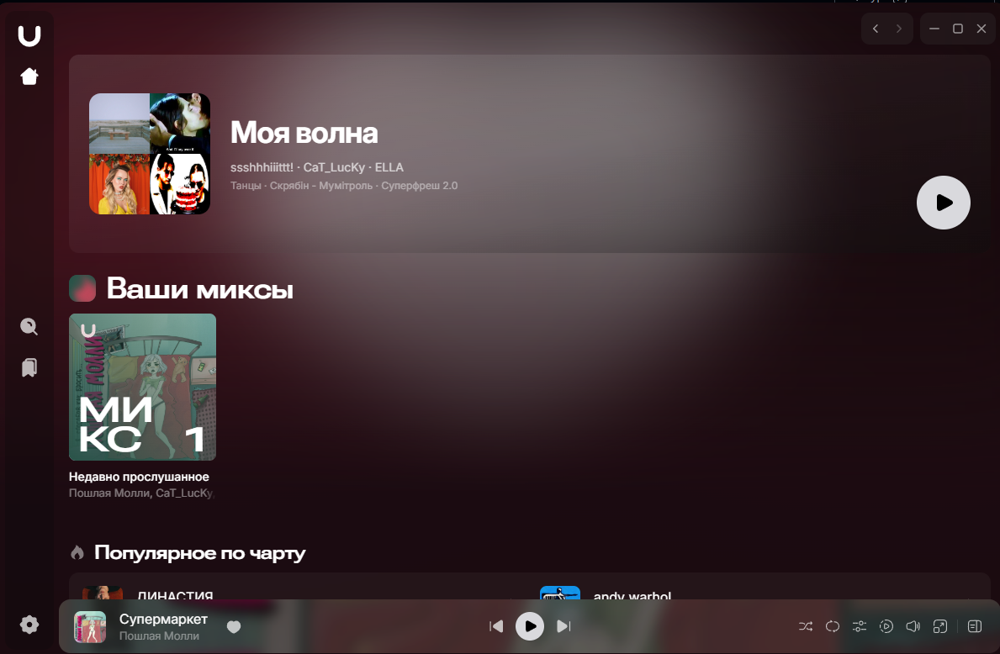
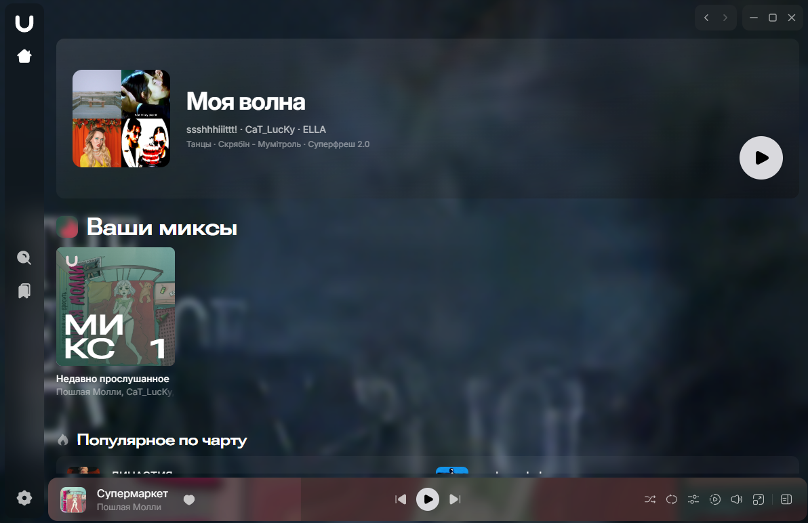

# Unify

Unify — музыкальный плеер для Windows. Находите музыку, собирайте свою библиотеку и читайте тексты песен прямо в плеере.

## Возможности

- **Поиск музыки.** Находите треки, исполнителей, альбомы и плейлисты в одном окне.
- **Библиотека.** Сохраняйте любимые треки, создавайте плейлисты и возвращайтесь к понравившимся исполнителям и альбомам.
- **Профили исполнителей.** Открывайте страницу артиста из трека и просматривайте его песни, альбомы и синглы.
- **Тексты песен.** Следите за подсветкой строк и слов по ходу песни, когда доступны таймкоды. Если есть несколько версий текста, выберите источник в плеере.
- **Скорость и тональность.** Настраивайте звучание для треков, которые поддерживают эти параметры.
- **Внешний вид.** Установите своё фото или видео на фон, выберите шрифт и настройте оформление.
- **Discord Rich Presence.** Показывайте друзьям в Discord, какой трек сейчас играет.

## Установка на Windows

1. Откройте [последний релиз Unify](https://github.com/klimori/Unify/releases/latest).
2. В разделе **Assets** скачайте `Unify-Setup-*.exe`.
3. Запустите установщик и откройте Unify.

Обновления можно проверить в **Настройки → О приложении → Проверить обновления**.

## Скриншоты

### Главная страница

### Плеер с текстом песни

### Библиотека

### Главная страница с пользовательским фоном

