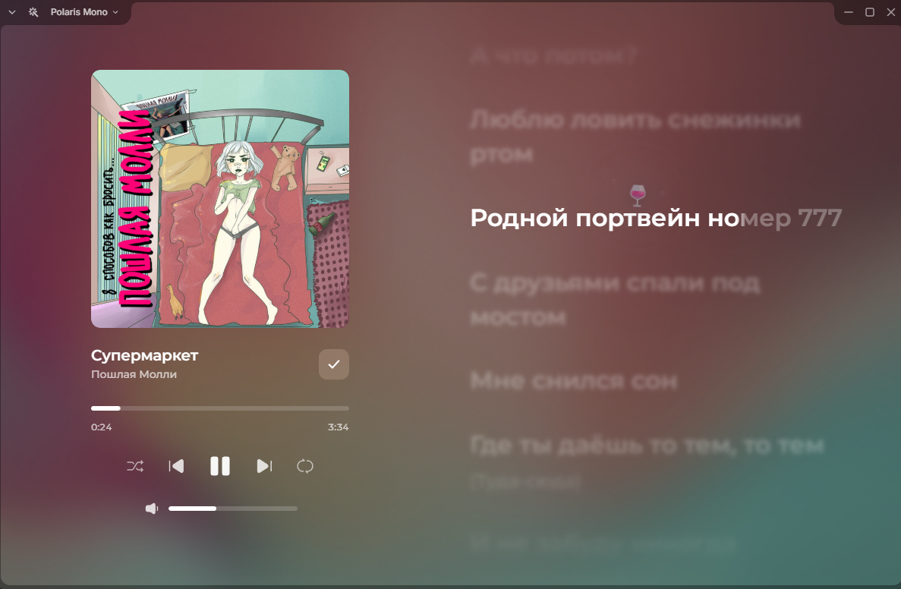
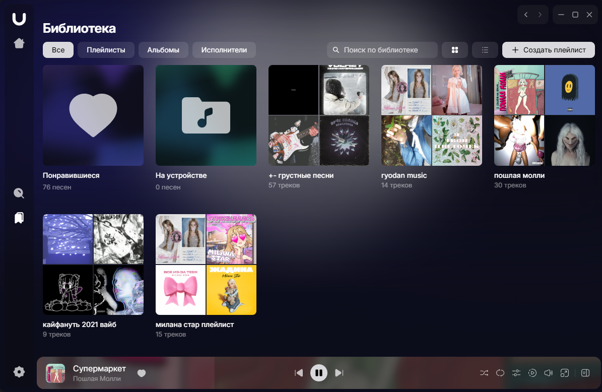

# Unify

Unify — музыкальный плеер для Windows с поиском музыки, библиотекой и синхронизированными текстами песен.

## Возможности

- **Поиск** — треки, исполнители, альбомы и плейлисты.
- **Библиотека** — сохранение треков, создание плейлистов и просмотр понравившихся исполнителей и альбомов.
- **Профили исполнителей** — песни, альбомы и синглы артиста.
- **Тексты песен** — подсветка строк и слов по таймкодам; выбор источника текста, если доступно несколько версий.
- **Скорость и тональность** — настройка воспроизведения для поддерживаемых треков.
- **Внешний вид** — фон из фото или видео, выбор шрифта и настройка оформления.
- **Discord Rich Presence** — отображение текущего трека в Discord.

## Установка

1. Скачайте `Unify-Setup-*.exe` из раздела **Assets** на странице [последнего релиза](https://github.com/klimori/Unify/releases/latest).
2. Запустите установщик и откройте Unify.

Проверить обновления можно в **Настройки → О приложении → Проверить обновления**.

## Скриншоты

### Главная страница

### Плеер с текстом песни

### Библиотека

### Пользовательский фон

